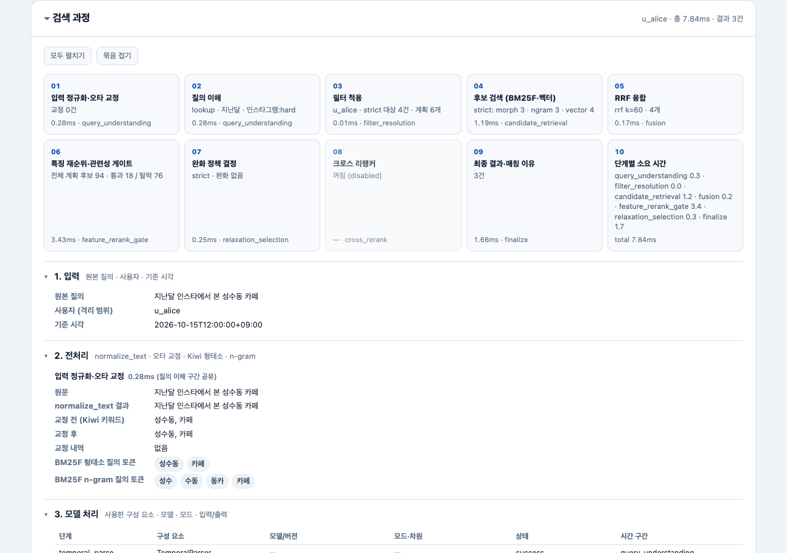
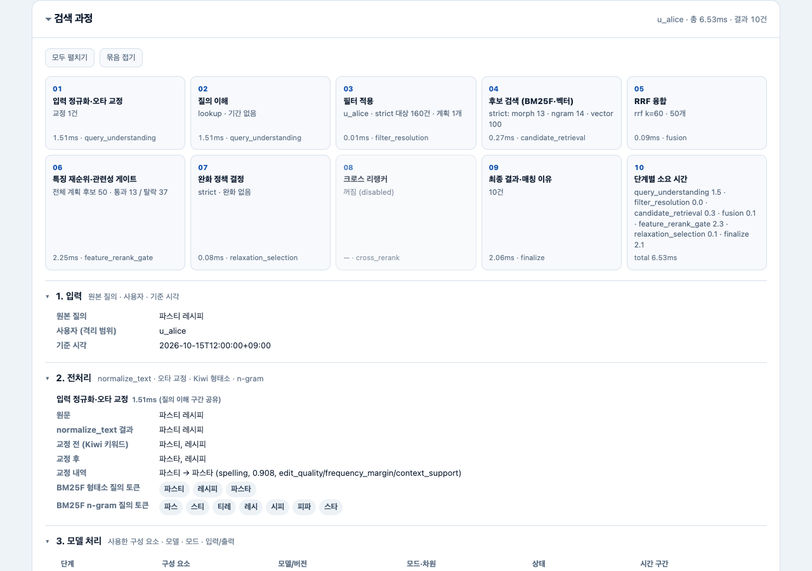
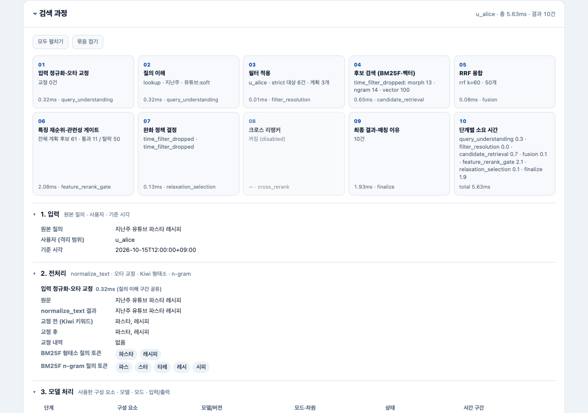

# Phase 2 구현 리포트: 검색 데모 "검색 과정" 패널

- 워크트리 / 브랜치: `phase-2-demo-search-trace` / `ultra-penguin/phase-2-demo-search-trace` (베이스 HEAD `e5f72b8`)
- 담당: Codex-Primary 역할 (이전 Codex 워커가 한도로 중단돼 Claude가 이어서 마무리)
- 작성일: 2026-11-03

## 1. 구현 범위

| 파일 | 변경 |
|---|---|
| `src/jupjup/search/service.py` | `explain=True`일 때만 `debug["pipeline"]`을 **추가**한다. 내용: 입력, 사용자, 해석된 필터, 완화 계획별 hard 필터·대상 문서 수·리트리버별 후보(전체)·RRF 융합 후보, 질의 토큰(형태소·n-gram), 재순위·게이트를 거친 전체 후보, 구성 요소 목록(이름·모델·모드·차원·상태·입출력), 크로스 리랭커 상태, 단계별 `timing_ms`. 질의 임베딩 종류 문자열 `"query"`를 상수 `_QUERY_EMBED_KIND`로 옮겼다 (값 동일). |
| `src/jupjup/demo/app.py` | `/demo/search`가 `explain=True`로 검색하고 응답에 `trace` 필드를 추가한다. 기존 필드(query, understanding, results, browse, applied_relaxations, empty_state, degraded, degraded_reasons, timing_ms)는 그대로다. `trace`는 6개 묶음 Pydantic 모델(`DemoSearchTrace`)이다. |
| `src/jupjup/demo/page.html` | 결과 아래에 펼치고 접을 수 있는 "검색 과정" 패널을 추가했다. 외부 자산 없이 동작한다. |
| `tests/integration/test_demo_trace.py`, `tests/integration/_search_digest.py` | 새 테스트 14개 (7절). |
| `tests/fixtures/search_trace/` | explain=False 해시 기준선(HEAD 코드로 생성), 대표 질의 3개 trace 스냅숏. |
| `specs/assets/phase2_demo_search_trace/*.png` | 1280×900 라이트 테마 캡처 3장 (보고서 첨부용). |

바꾸지 않은 것: 검색 순위·점수 로직, 검색 기준선(`data/baselines`), `data/recordings`, `src/jupjup/providers`, `src/jupjup/ingest`, 루프백 바인드 검사(`demo serve`), 사용자 격리(인덱스·저장소 모두 `user_id`로 조회).

### 1.1 후속 조치표 (2026-11-03, Phase 3 낮음 항목 정리)

| 출처 | 항목 | 조치 | 재현·검증 |
|---|---|---|---|
| `phase4_review_demo-trace_loop1.md` L1 | 비활성 크로스 리랭커 상태가 상세 객체에서는 `null`, 구성 요소에서는 `skipped:disabled` | 검색 서비스는 건드리지 않고 데모 변환 계층이 같은 explain 응답의 `cross_rerank` 구성 요소 상태를 상세 객체에도 사용한다. 대표 스냅숏 3개를 `skipped:disabled`로 갱신했다 | 수정 전 `test_trace_schema_and_legacy_fields` 실패(`None != "skipped:disabled"`), 수정 후 통과 |
| 같은 문서 L2 | 중첩 evidence의 출처 일치가 일부만 직접 검증됨 | 계획별 hard filter·대상 문서 수, 검색 `matched_fields`, 융합 `raw_scores`, 재순위 `features`·gate, 구성 요소 이름·모델·입출력, 실행 로그 전체를 대표 3경로에서 source debug와 대조한다. 강화 테스트가 찾아낸 누락 `gate.signal_profile`도 trace에 보존한다 | `test_trace_values_come_from_service_explain` 3경로 통과 |
| PM 추가 범위 | 화면 오른쪽 위가 실행 모드와 무관하게 `로컬 검색 데모 · Mock`으로 고정됨 | HTML에는 모드 자리표시자만 두고, `GET /` 응답을 만들 때 서버의 `active.settings.mode`(`mock`/`recorded`/`live`)를 주입한다 | 수정 전 세 모드 재현 테스트 모두 실패, 수정 후 `test_demo_page_shows_server_runtime_mode` 3모드 통과 |

이 후속 작업은 `src/jupjup/demo/`, 데모 통합 테스트와 trace fixture만 수정했다. 별도 트랙 범위인
`src/jupjup/api`, `storage`, `domain`, `ingest/service.py`, `ingest/jobs.py`, `ingest/worker.py`는 수정하지 않았다.

후속 검증은 `uv run pytest` **1348 passed, 5 deselected**, `uv run ruff check src tests scripts`,
`uv run mypy src`(90개 소스), `git diff --check` 모두 통과했다.

### explain=False 경로가 바뀌지 않는다는 증거
- 새 계산은 모두 `if explain` 안에서만 한다 (`time.perf_counter()` 호출, 대상 문서 수 세기, dict 생성).
- **바이트 비교:** `data/golden/queries.jsonl` 235개와 `challenge_queries.jsonl` 24개 총 259개 질의를 mock과 recorded 두 모드로 돌려, `SearchResult`에서 `query_id`(무작위)와 `timing_ms`(실행 시간)만 빼고 정렬 JSON의 sha256을 만들었다. 기준선은 **수정 전 코드(HEAD `e5f72b8`)를 임시 워크트리에 체크아웃해** 만들었고, 현재 코드의 518개 해시가 모두 같다 (`test_explain_false_results_byte_identical_to_baseline`).
- `explain=True`로 돌려도 결과 항목(디버그 제외)과 나머지 필드가 explain=False와 같다 (`test_explain_true_does_not_change_ranking`, 60개 질의).
- `eval run` 지표 JSON을 HEAD 코드 실행 결과와 비교하면 지연 시간을 뺀 모든 값이 같다 (8절).

## 2. 화면 구성

- 패널 머리: "검색 과정", 오른쪽에 `사용자 · 총 시간 · 결과 수`. `
`라서 통째로 접을 수 있다.
- 도구: "모두 펼치기"(나머지 행 포함 전부 펼침), "묶음 접기".
- **단계 요약 카드 10개 (5열 × 2행):** 번호, 제목, 핵심 수치, `timing_ms · 시간 구간 키`. 가로 1280px에서 패널 머리와 카드 10개가 한 화면에 들어온다 (위 캡처). 건너뛴 단계(크로스 리랭커 꺼짐 등)는 흐리게, degraded 단계는 주황 테두리로 표시한다.
  1 입력 정규화·오타 교정 / 2 질의 이해 / 3 필터 적용 / 4 후보 검색(BM25F·벡터) / 5 RRF 융합 / 6 특징 재순위·관련성 게이트 / 7 완화 정책 결정 / 8 크로스 리랭커 / 9 최종 결과·매칭 이유 / 10 단계별 소요 시간
- **6개 묶음** (각각 펼침·접기): 1 입력, 2 전처리, 3 모델 처리, 4 분석 결과, 5 근거, 6 실행 로그.
- 표는 상위 10행만 보이고, 나머지는 "나머지 N개 펼치기"로 접혀 있다. 선택된 완화 계획과 최종 선택 후보는 행을 강조한다. 선택되지 않은 완화 계획의 후보 표는 "다른 완화 계획 N개 펼치기" 안에 있다.
- 인쇄: `@media print`에서 라이트 색으로 고정하고 예시 칩·흐름 표시·도구 버튼을 숨기며, `beforeprint`에서 묶음을 모두 펼친다. 화면 자체도 기존 page.html의 토큰(색·반경·글꼴)을 그대로 쓴다.
- 좁은 화면(390px)에서도 가로 스크롤이 생기지 않는다 (`scrollWidth` 390 확인). 표는 자체 가로 스크롤 상자 안에 있다.

## 3. 6개 묶음별 데이터 출처

모든 값은 `SearchService.search(SearchRequest(..., explain=True))` 한 번의 실행 결과에서 온다. 데모 계층은 값을 다시 계산하지 않고 옮기기만 한다. 예외는 후보 **제목**이다. 같은 `user_id`로 `repo.get_bundles`를 불러 제목을 붙인다 (격리 유지).

| 묶음 | trace 필드 | 출처 |
|---|---|---|
| 1 입력 | `input_data.query/user_id/now` | `debug.pipeline.input` (요청 값, `now`는 서비스가 실제로 쓴 기준 시각) |
| 2 전처리 | `preprocessing.normalization.original/normalized/corrections` | `SearchResult.understanding` (`ParsedQuery.original`, `normalize_text` 결과인 `normalized`, `SpellCorrector`의 `corrections`) |
| | `correction_before` / `correction_after` | `ParsedQuery.raw_keywords`(Kiwi 키워드 후보, 교정 전) / `ParsedQuery.keywords`(교정 후) |
| | `morph_tokens` / `ngram_tokens` | `debug.pipeline.query_terms` = `SearchService.morph_terms()` / `ngram_terms()`가 BM25F 형태소·n-gram 인덱스에 실제로 넘긴 질의 토큰 |
| 3 모델 처리 | `model_processing.components[]` | `debug.pipeline.components`: 실제 객체의 클래스 이름(`TemporalParser`, `FacetExtractor`, `IntentClassifier`, `BM25FIndex`, 임베더 클래스, `fuse_rrf`, `RelevanceScorer`, `RelevanceGate`, `RelaxationPolicy`, `CrossRerankStage`), 모델 id·버전(`embedder.model_id`, `settings.relevance.version`, `cross_rerank.model_id`), 임베딩 종류(`query`)·차원(`embedder.dim`), RRF `k`·가중치, 완화 최소 개선폭, 단계별 입력과 출력. `provider_mode`(mock/recorded/live)는 `container.settings.mode` |
| | `model_processing.cross_reranker` | `debug.pipeline.cross_reranker` (구성됨·켜짐·상태), 시간은 `SearchResult.timing_ms.cross_rerank` (실행했을 때만) |
| 4 분석 결과 | `analysis.understanding.value` | 기존 응답의 `understanding`과 같은 객체 (의도, 기간 표현·기간·기간 창, 플랫폼·유형 facet과 hard/soft, 키워드, 목적어, 의미 질의) + `ParsedQuery.warnings` |
| | `analysis.final.results` | 기존 응답의 `results`와 같은 목록 (점수, 완화 여부, 매칭 이유) |
| 5 근거 | `evidence.filtering` | `debug.pipeline.user_id/filters/plans[].hard_filter/eligible_document_count` (계획별 hard 필터와 그 필터를 통과하는 사용자 문서 수) |
| | `evidence.retrieval` | `debug.pipeline.plans[].retrievers.{morph,ngram,vector}` = 각 리트리버가 돌려준 `RetrievalHit` 전체(순위, 점수, 일치 필드)와 후보 수. 벡터 점수는 코사인 유사도 |
| | `evidence.fusion` | `debug.pipeline.plans[].fused_candidates` (`fuse_rrf` 결과: RRF 점수, 리트리버별 순위, 원점수), `debug.pipeline.fusion` (방법, k, 가중치) |
| | `evidence.reranking` | `debug.pipeline.scored_candidates`: 모든 계획 후보의 합집합을 서비스의 정렬 키 순서로. 관련도(`final_score`), 특징값(`semantic_raw`, `original_lexical`, `canonical_lexical`, `phrase`, `purpose`, `facet_cost`, `utility` 등), 게이트 판정(통과 여부, 이유, 문턱값, 증거 프로필), 최종 선택 여부 |
| | `evidence.relaxation` | `debug.relaxation_decision` (기존 필드): 선택 계획, 계획별 시도(검색 후보 수, 범위 내 후보 수, 게이트 통과 수, 1위, 채택 여부, 이유, 게이트 탈락 사유 상위 3개). 적용 완화는 `SearchResult.applied_relaxations` |
| 6 실행 로그 | `execution_log.entries[]` | 구성 요소별 `status`(success/skipped/degraded, `skipped:disabled` 같은 세부 사유는 `detail`)와 `debug.pipeline.timing_ms`의 해당 구간 값 |
| | `degraded`, `degraded_reasons`, `errors` | `SearchResult.degraded/degraded_reasons`. `errors`는 상태가 degraded·failed인 구성 요소의 사유만 담는다 (없으면 빈 목록) |
| | `timing_ms` | `debug.pipeline.timing_ms`: `query_understanding`, `filter_resolution`, `candidate_retrieval`, `fusion`, `feature_rerank_gate`, `relaxation_selection`, `finalize`, `total` |

**시간 구간 설명 (추정 없음):** `QueryUnderstander.parse()`는 정규화·기간·facet·의도·교정을 한 번에 처리하므로, 1·2단계와 temporal/facet/intent 구성 요소는 같은 `query_understanding` 구간 값을 함께 보여준다 (화면에 "질의 이해 구간 공유"라고 적었다). BM25F와 벡터 검색도 계획마다 함께 실행되므로 `candidate_retrieval` 하나로 잰다. 특징 재순위와 게이트도 같은 루프라서 `feature_rerank_gate` 하나다. 구간을 쪼개려고 값을 나누거나 추정하지 않았다.

## 4. 대표 질의 3개의 실제 trace (mock, u_alice, now=2026-10-15T12:00+09:00)

값은 `tests/fixtures/search_trace/*.json` 스냅숏과 `demo serve` 실제 요청 결과에서 옮겼다. 시간은 실행마다 조금씩 다르다 (아래는 `demo serve` 한 번의 값).

### 4.1 기간+플랫폼: "지난달 인스타에서 본 성수동 카페"
- 전처리: 정규화 결과 `지난달 인스타에서 본 성수동 카페`, 교정 없음. 키워드 `성수동, 카페`, 형태소 토큰 `성수동, 카페`, n-gram 토큰 `성수, 수동, 동카, 카페`.
- 질의 이해: intent `lookup`, 기간 `지난달` = 2026-09-01 ~ 2026-10-01, 기간 창 2026-08-25 ~ 2026-10-08, 플랫폼 `instagram`(hard), 의미 질의 `성수동 카페`.
- 필터: 사용자 `u_alice`, 완화 계획 6개. strict(인스타 + 기간 창)의 대상 문서는 4건이고, `time_filter_dropped+platform_filter_dropped` 계획은 160건이다.
- 후보 검색 (strict): 형태소 3건, n-gram 3건, 벡터 4건. 1위는 셋 다 `c_alice_0001` (BM25 형태소 3.8319, n-gram 8.0255, 벡터 유사도 0.6246).
- RRF (k=60): `c_alice_0001` 0.042623 (순위 1/1/1), `c_alice_0026` 0.041935, `c_alice_0016` 0.041270.
- 게이트: 전체 계획 후보 94개 중 통과 18, 탈락 76.
- 완화: strict 선택, 이유 `strict_candidate`. 다른 5개 계획은 모두 `same_top`(1위가 같음)이라 채택되지 않았고, 적용된 완화는 없다.
- 크로스 리랭커: 구성됨, 꺼짐, `skipped:disabled`.
- 최종 3건: `c_alice_0001`(0.8374), `c_alice_0026`(0.6440), `c_alice_0016`(0.5695). 매칭 이유는 keyword, semantic, time, platform.
- 시간: total 7.84ms (`demo serve` 실행 한 번 기준).

### 4.2 오타: "파스티 레시피"

- 교정: `파스티 → 파스타` (spelling, 신뢰도 0.908, 근거 edit_quality / frequency_margin / context_support). 교정 전 키워드 `파스티, 레시피`, 교정 후 `파스타, 레시피`.
- 형태소 토큰은 `파스티, 레시피, 파스타`로, 원형과 교정형을 모두 검색한다. n-gram 토큰은 `파스, 스티, 티레, 레시, 시피, 피파, 스타`. 의미 질의는 원문 `파스티 레시피`.
- 필터: 기간·플랫폼이 없어서 strict 계획 하나뿐이고 대상 문서는 160건.
- 후보 검색: 형태소 13건, n-gram 14건, 벡터 100건. 벡터 1위는 `c_alice_0068`(0.4448), BM25 1위는 `c_alice_0041`.
- RRF: `c_alice_0041` 0.042103 (형태소 1, n-gram 1, 벡터 3), `c_alice_0042` 0.040958, `c_alice_0068` 0.040330 (형태소 8, n-gram 5, 벡터 1).
- 게이트: 통과 13, 탈락 37. 완화 없음 (`strict_candidate`).
- 최종 10건, 1위 `c_alice_0041` "15분 토마토 파스타 레시피" (0.7792).

### 4.3 strict 결과 없음 → 완화: "지난주 유튜브 파스타 레시피"

- 질의 이해: 기간 `지난주` = 2026-10-05 ~ 2026-10-12, 기간 창 2026-10-02 ~ 2026-10-15. 플랫폼 `youtube`는 **soft**(선호일 뿐 필터가 아님).
- 필터 계획: strict(대상 6건), time_window_expanded(14건), time_filter_dropped(160건).
- 완화 시도:
  - strict: 범위 내 후보 0, `all_candidates_rejected`, 채택 안 됨
  - time_window_expanded: 범위 내 후보 0, `all_candidates_rejected`, 채택 안 됨
  - time_filter_dropped: 게이트 통과 11, `accepted`, **선택**
- 적용 완화: `time_filter_dropped`. 최종 10건이 모두 `relaxed=true`이고 1위는 `c_alice_0041`(0.8688).
- 선택 계획의 후보 검색: 형태소 13건, n-gram 14건, 벡터 100건. RRF 1위 `c_alice_0041` 0.042359.

## 5. 응답 크기
`trace`에는 계획별 리트리버 후보가 모두 들어간다 (n_lex·n_vec = 100). 데모 응답은 약 70~200KB다 (기간+플랫폼 질의는 계획 6개라 155KB). 로컬 dev 데모라서 그대로 두었고, 화면은 상위 10개만 펼쳐 보여준다.

## 6. 설계·지시와 달라진 점
- 이전 워커는 debug의 `feature_rerank` 구성 요소를 `FeatureReranker`(`self.reranker`)로 표시했다. 하지만 순위 경로에서 특징 점수를 실제로 계산하는 것은 `RelevanceScorer`라서 실제 객체 이름으로 고쳤다.
- 관련도·완화 버전 문자열은 설정값 `settings.relevance.version`(= `relaxation-v2.2`)을 그대로 보여준다. 이름이 "relaxation"으로 시작하지만 설정에 있는 실제 값이라 바꾸지 않았다.
- "Kiwi 형태소 토큰"은 Kiwi가 만든 키워드 후보(`raw_keywords`, 교정 전)와 BM25F 형태소 인덱스에 실제로 넘긴 질의 토큰(`morph_terms`)으로 보여준다. Kiwi의 형태소 분석 원결과(품사 태그)는 서비스가 보관하지 않아서 넣지 않았다 (값을 만들지 않는 원칙).

## 7. 테스트 목록 (`tests/integration/test_demo_trace.py`, 14개)
1. `test_trace_schema_and_legacy_fields`: 기존 응답 필드가 유지되는지, trace가 6개 묶음과 `timing_ms`인지, `DemoSearchTrace` 검증, 단계 번호 1~9, 구성 요소 순서, 벡터 모델·차원·모드, 크로스 리랭커 기본 꺼짐.
2. `test_page_has_trace_panel`: 패널, 6개 묶음, 10행 제한, 인쇄 스타일, 외부 자산이 없는지.
3. `test_trace_values_come_from_service_explain[period_platform|typo|empty_then_relaxed]`: 엔드포인트가 받은 `SearchResult`를 spy로 잡아, trace의 시간·입력·정규화·교정·토큰·필터·리트리버 순위와 점수·RRF·재순위와 게이트·완화·최종 결과·구성 요소 상태·degraded가 explain 결과와 같은지 확인 (3개).
4. `test_browse_trace_marks_skipped_stages`: 필터 전용 둘러보기에서 검색과 완화 단계가 skipped로 표시되는지.
5. `test_trace_is_isolated_per_user`: u_bob 질의의 trace에 `c_bob_` 문서만 나오는지.
6. `test_explain_false_results_byte_identical_to_baseline[mock|recorded]`: 259개 질의 × 2개 모드 해시가 HEAD 기준선과 같은지 (2개).
7. `test_explain_true_does_not_change_ranking`: explain을 켜도 결과가 같은지.
8. `test_representative_trace_snapshot[...]`: 대표 질의 3개의 trace 스냅숏 (시간 제외, 표 상위 10개) (3개).
9. `test_representative_traces_show_expected_pipeline_behaviour`: 기간+플랫폼 hard 필터, `파스티→파스타` 교정, strict 실패 후 `time_filter_dropped` 채택.

기존 `tests/integration/test_demo.py` 9개도 그대로 통과한다.

## 8. 직접 실행한 명령과 결과
| 명령 | 결과 |
|---|---|
| `uv run pytest` | 종료 0, 1333개 통과, 실패·건너뜀 0 (pyproject addopts의 `not embed and not rerank and not local_llm` 마커 제외 기준) |
| `uv run ruff check src tests` | All checks passed |
| `uv run mypy src` | Success: no issues found in 90 source files |
| `uv run jupjup eval validate` | 종료 0 |
| `uv run jupjup eval run --mode mock --split dev --baseline data/baselines/mock.json` | 종료 0. recall@10 0.9620, mrr@10 0.9958, ndcg@10 0.9795, time_exact 1.0, platform_f1 1.0 |
| `... --mode mock --split test` | 종료 0. recall@10 0.9420, mrr@10 0.9867, ndcg@10 0.9589 |
| `... --mode recorded --split dev --baseline data/baselines/recorded.json` | 종료 0. recall@10 0.9712, mrr@10 1.0000, ndcg@10 0.9860 |
| `... --mode recorded --split test` | 종료 0. recall@10 0.9720, mrr@10 0.9911, ndcg@10 0.9801 |
| 같은 4개 eval을 HEAD 코드(`PYTHONPATH=<HEAD 워크트리>/src`)로 실행해 리포트 JSON 비교 | 지연 시간을 뺀 모든 지표가 같음 (4/4) |
| `jupjup seed load --db <scratch>/demo.db --strict` 후 `jupjup demo serve --db <scratch>/demo.db --port 8781` | 127.0.0.1 바인드 확인. 8780은 PM 워크트리의 live 데모가 쓰고 있어 건드리지 않았다 |
| `curl -X POST http://127.0.0.1:8781/demo/search` (대표 질의 3개) | 200, 응답 크기 155KB / 74KB / 91KB, 값은 4절과 같음 |
| headless Chrome(Playwright)로 1280×900 라이트 테마 캡처, 390px 폭 확인 | JS 오류 없음 (favicon 404만 있음, 기존 동작), 390px에서 가로 넘침 없음 |

## 9. 남은 문제
- 1·2단계, BM25F·벡터, 재순위·게이트는 실제 실행 구조상 시간 구간을 공유한다. 단계별로 따로 재려면 `QueryUnderstander.parse()` 안쪽에 계측을 넣어야 하는데, 이번 범위(검색 로직 무변경)를 넘어서 하지 않았다.
- 크로스 리랭커를 켜면 그 추론 시간이 `feature_rerank_gate` 구간에도 들어간다. 단독 시간은 `cross_rerank` 키로 따로 표시된다.
- trace 응답이 최대 약 200KB다. 데모가 아닌 공개 API에 쓰려면 후보 목록을 상위 N개로 자르는 옵션이 필요하다.
- 기존 page.html은 dark 테마도 지원한다. 패널도 같은 토큰을 따르지만, 캡처와 인쇄 품질은 라이트 테마 기준으로만 확인했다.
- 실행 중인 PM 워크트리의 8780 데모 서버는 이 변경을 포함하지 않는다. 병합 후 재시작하면 반영된다.
